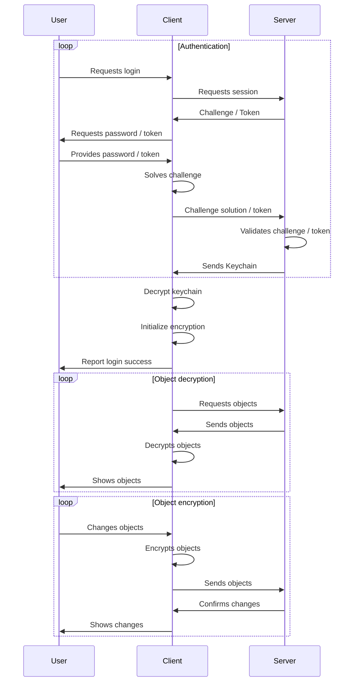
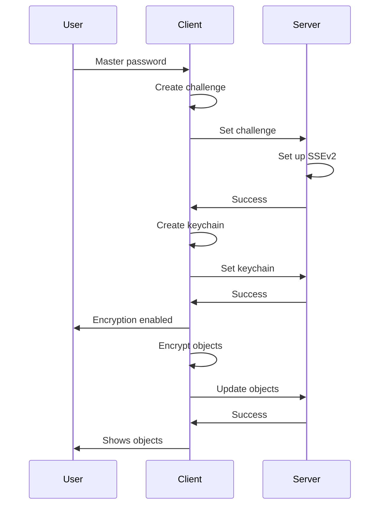
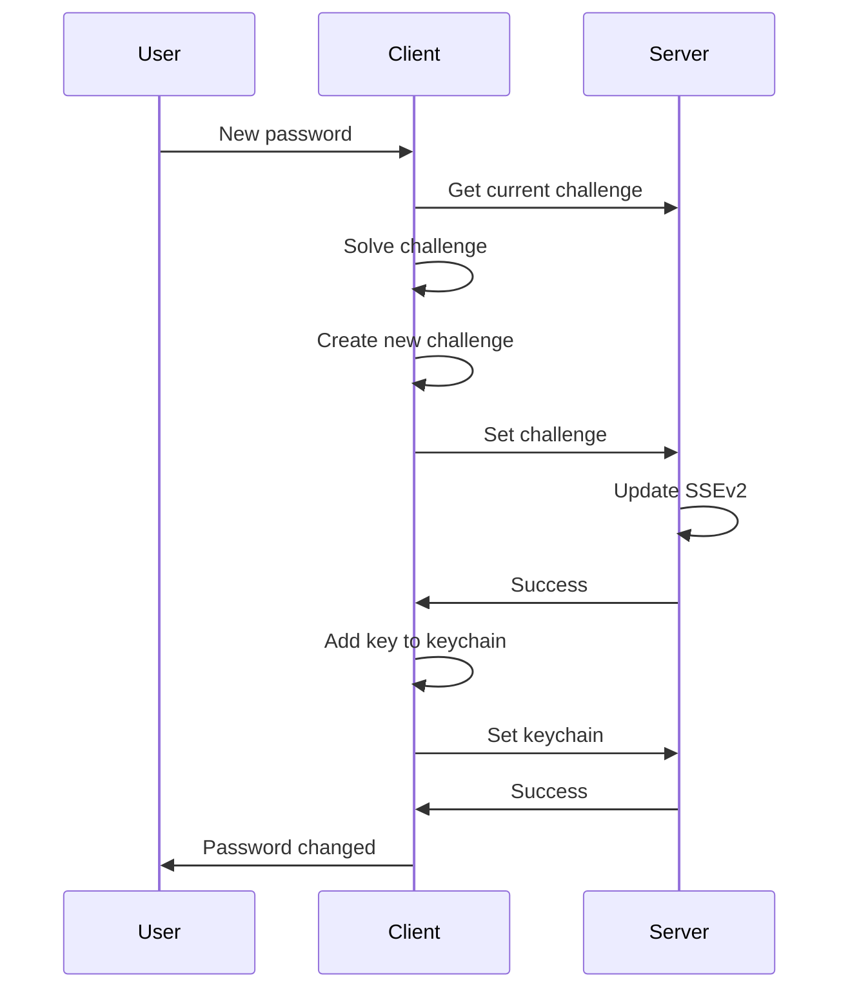

### How does Passwords implement CSE/E2E
Passwords uses [Libsodium](https://download.libsodium.org/doc) to encrypt and decrypt user data.
Implementations of Libsodium are available for many different programming languages and usually provide a very similar api.
The library also provides good performance and security while being comparably easy to use.
E2E in Passwords is designed to be upgradeable which is why every part of it is implemented separately and has its own version information.

### Avoiding user confusion
It can not be expected that users have any idea what e2e/cse is and how it works.
Keep this in mind when designing and developing the ui related to encryption.

Here are some terms you should use when talking to users about encryption:

- **Encryption Password** / **Encryption Passphrase** is the password the user has chosen during the encryption setup.
  Experience has shown that users will enter their Nextcloud password repeatedly and get locked out of the app if they're just asked for the "password".
- **End-to-End Encryption** / **End to End Encryption** is the term used to describe client side encryption to users.
  Using different terms to describe the same functionality will confuse users.
  Additionally, users may not know what a client is.

### Encryption and Token types
##### Password challenge
| Type | Description |
| --- | --- |
| [`PWDv1r1`](./Encryption/PWDv1Challenge) | The standard master password challenge |

##### Keychains
| Type | Description |
| --- | --- |
| [`CSEv1r1`](./Encryption/CSEv1Keychain) | The standard CSE keychain |

##### CSE/E2E encryption
The default CSE chosen by the user is set in `user.encryption.cse`.

| Type | Description |
| --- | --- |
| `none` | An object without any client side encryption. Only available with SSE other than `none` |
| [`CSEv1r1`](./Encryption/CSEv1Encryption) | The standard CSE encryption. Can not be used for shared entities. |

##### SSE encryption
The default CSE chosen by the user is set in `user.encryption.sse`.

| Type | Description |
| --- | --- |
| `none` | An object without any server side encryption. Only available with CSE other than `none` |
| `SSEv1r1` | An object with first generation server side encryption. Uses a server key, user key and object key |
| `SSEv1r2` | An object with second generation server side encryption. Uses the Nextcloud secret, user key and object key |
| `SSEv2r1` | An object with secure server side encryption. SSEv2 uses a keychain which is temporarily decrypted with the challenge secret |

##### 2FA token
| Type | Description |
| --- | --- |
| [`user-token`](./Api/Token-Api#user-token) | A token where the user has to enter a code |
| [`request-token`](./Api/Token-Api#request-token) | A token where a second device or app is used for confirmation |

### The encryption flow
This diagram explains the process which is necessary to use encryption.

### Set up encryption
This diagram explains the process which is necessary to set up encryption

#### Notes
 - When migrating objects without encryption, it is recommended to delete the old object and create a new one

### Change the master password
This diagram explains the process which is necessary to change the users master password

