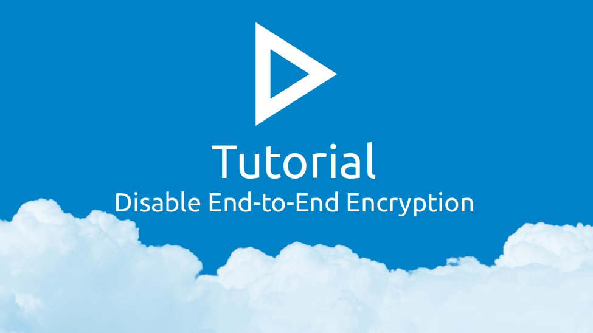

## Before you start
There is no built-in option to disable end-to-end encryption.
Passwords a functionality to store hidden passwords, tags and folders and also keeps previous revisions of any change made to any item.
These features prevent removing the encryption passphrase or would leave some items permanently encrypted and unreadable.
You can follow these steps to export all your data, reset the app and start again without encryption:

> :exclamation: This process will delete any hidden items and all settings if not recovered before

1. Make sure you have no hidden items or use the [Recover hidden items](../Settings#recover-hidden-items) option to show them all.
2. Exit or log out of any client but the Nextcloud app itself
3. Ask your admin to make a backup using passwords backup command
4. Make a complete, unencrypted [database export](../Export#database-backup)
5. Check the contents of the export with a text editor to verify that your data is exported correctly
6. Go into `Settings` and use the option to reset everything in the `Danger Zone`
7. [Import the database backup](../Import/Import-from-Backup)
8. Delete the backup file and restore your settings