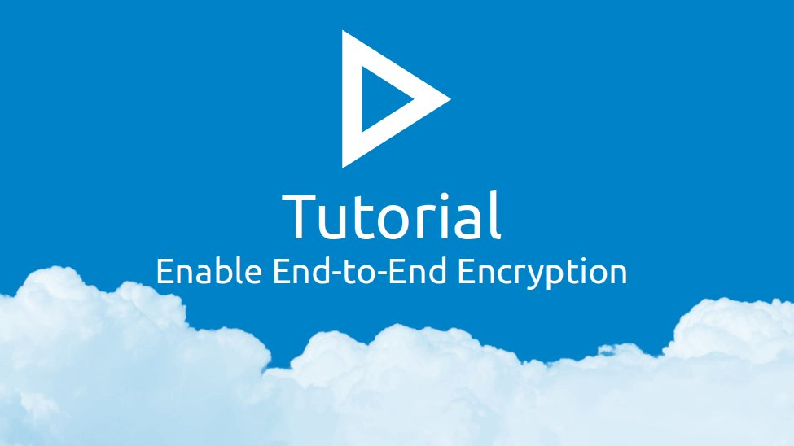

The passwords app offers strong end-to-end encryption which requires anyone trying to decrypt your passwords to know the encryption passphrase.

#### Before you start
- By default, the encryption setup will encrypt all existing passwords, folders and tags except those who are shared.
- All previous revisions but the current will be deleted.
- The encryption setup will also create a new password entry with your encryption passphrase.
  If you do not want this, switch the settings view to "Advanced" in the top right corner and uncheck the options in step 5 of the setup.
- The encryption setup will create the new entries before deleting any old ones.
  So even if something goes wrong, there should be no data loss.

#### Enabling End-to-End encryption
1. Open the [Settings](web+passlink://goto/settings) (the cog icon)
2. Locate the "Encryption" section at the end of the "Security" section.
3. Click the "Activate" button next to "End-to-End Encryption".
4. The setup wizard will appear. Click continue to see the encryption passphrase dialog.
5. Choose an encryption passphrase with at least 12 characters and confirm it.
   > :warning: Do not use your Nextcloud password.
   > Every Nextcloud app can read your Nextcloud password and it offers no security
6. Click "Save".

The encryption setup will automatically encrypt all folders and passwords

> :warning: Do not abort the encryption process or reload the page