## Images
[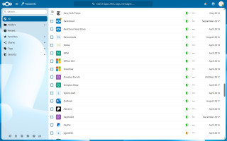](./_files/main-section.png)
[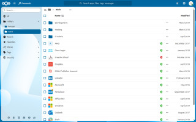](./_files/folder-section.png)
[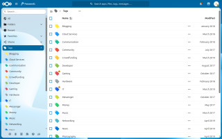](./_files/tag-section.png)
[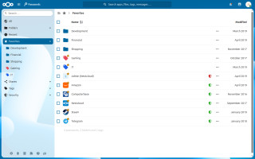](./_files/favorites-section.png)
[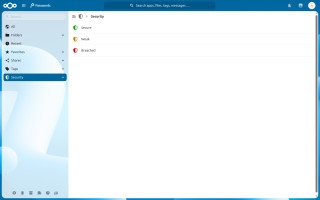](./_files/security-section.png)
[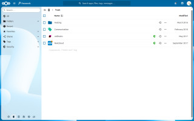](./_files/trash-section.png)
[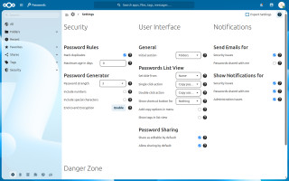](./_files/settings-section.png)
[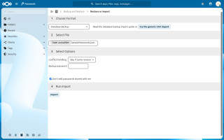](./_files/import-section.png)
[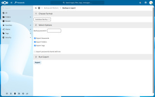](./_files/export-section.png)
[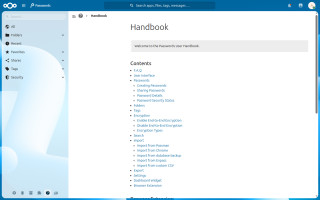](./_files/handbook-section.png)

## Feature Overview
The short video below quickly shows you all the major features of passwords.
[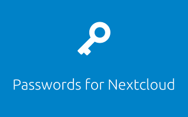](https://raw.githubusercontent.com/wiki/marius-wieschollek/passwords/_files/videos/feature-overview.mp4)